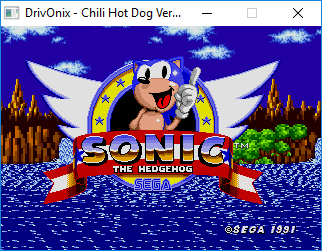
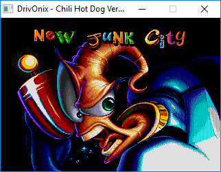
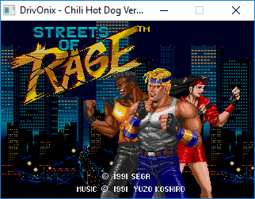
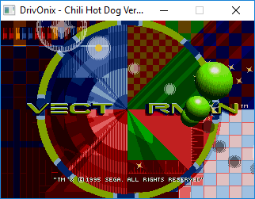
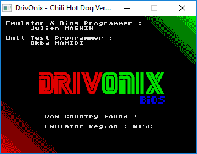

# GameBoo
```bash


 ______             _            ___              _           
|_   _ `.          (_)         .'   `.           (_)          
  | | `. \ _ .--.  __  _   __ /  .-.  \ _ .--.   __   _   __  
  | |  | |[ `/'`\][  |[ \ [  ]| |   | |[ `.-. | [  | [ \ [  ] 
 _| |_.' / | |     | | \ \/ / \  `-'  / | | | |  | |  > '  <  
|______.' [___]   [___] \__/   `.___.' [___||__][___][__]`\_] 
                                                              


  Emulator and Bios Programmer : Julien Magnin (MS-DOS1999)
  Unit Test Programmer : Okba Hamidi (acceleratorlastorder)
 ```

DrivOnix is a SEGA Megadrive/Genesis emulator for Linux and Windows, written in C++/CSFML.
The current implementation includes the 68000, Z80, VDP, FM/PSG audio, cartridge saves and controller protocols. See the test coverage and remaining accuracy boundaries below; a commercial-game compatibility matrix has not been established.



## Installation

The [release workflow](.github/workflows/releases.yml) generates Windows x64
ZIP, Linux x86_64 tar.gz and Ubuntu 24.04 amd64 `.deb` packages. Version tags
publish these to [GitHub Releases](https://github.com/acceleratorlastorder/DrivOnix-Genesis_Megadrive_Emulator/releases)
with SHA-256 checksums after both platforms and CPU tests pass. Ordinary CI and
manual preview runs keep downloadable packages as Actions artifacts for 14 days.

Extract the Windows ZIP and run `bin/DrivOnix.exe`; its dependency DLLs and MSVC
runtimes are included. On Ubuntu 24.04 or a compatible newer system, install a
downloaded `.deb` with `sudo apt install ./DrivOnix-*.deb` and run `DrivOnix`.
The Linux tarball preserves executable permissions and the `bin/` + `share/`
layout; it requires CSFML 2 and GTK 3 runtime libraries and a compatible Ubuntu
24.04/glibc baseline. It is not a distribution-independent static bundle.

See [RELEASING.txt](RELEASING.txt) for tag releases, prereleases and manual
previews, or build from source below.

### Building from source

Clone this repository:

```sh
git clone https://github.com/acceleratorlastorder/DrivOnix-Genesis_Megadrive_Emulator.git
cd DrivOnix-Genesis_Megadrive_Emulator
```

#### Linux (Debian / Ubuntu)

```sh
sudo apt-get update
sudo apt-get install build-essential cmake pkg-config python3 libcsfml-dev libgtk-3-dev
cmake -S . -B build/linux -DCMAKE_BUILD_TYPE=Release
cmake --build build/linux --parallel 2
./build/linux/DrivOnix
```

Run without arguments to select a ROM in the GTK file picker, or pass its path:

```sh
./build/linux/DrivOnix "/path/to/My Game.bin"
```

This is a native Linux build of the full graphical emulator. CSFML **2.x** is
required; CSFML 3 uses a different API. On Wayland desktops, XWayland must be
available because CSFML 2 uses X11. Other distributions need a C++14 compiler,
CMake 3.16 or newer, CSFML 2 development files, GTK 3 development files and
pkg-config. Python 3.9 or newer is needed to run tests; pass
`-DBUILD_TESTING=OFF` when building without Python.

The build copies `Bios/DrivOnix.bios` and `Config/config.txt` alongside the
executable, so it can be launched from another working directory or via `PATH`.
Keep those directories with the executable when moving the build. An optional
installation uses the usual `bin/` and `share/drivonix/` layout:

```sh
cmake --install build/linux --prefix "$HOME/.local"
"$HOME/.local/bin/DrivOnix" "/path/to/game.bin"
```

#### Windows

The original 32-bit MinGW build is still available:

```bat
compile.bat
```

It uses CMake, a C++14 MinGW toolchain, matching installed CSFML 2 headers, and the bundled 32-bit CSFML import libraries/DLLs. For a native
64-bit MSVC build, build matching dependencies and use CMake (Visual Studio
2022 C++ tools, CMake and Python required):

```powershell
python .github/scripts/build_windows_csfml.py --prefix build/deps
cmake -S . -B build/windows -A x64 -DCSFML_ROOT="$PWD/build/deps"
cmake --build build/windows --config Release --parallel 2
Copy-Item build/deps/bin/*.dll build/windows/Release/
./build/windows/Release/DrivOnix.exe
```

The Windows dependency helper verifies pinned SFML 2.6.2 and CSFML 2.6.1 source
archives before building them. The native CMake builds do not use the bundled
32-bit Windows libraries.

#### Tests

Run frontend and ROM-loader checks with `ctest --test-dir build/linux
--output-on-failure` (on Windows add `-C Release` and use `build/windows`). The
Linux GUI smoke test generates an original test ROM and checks the picker,
BIOS handoff, rendered red/green frames, controller input and clean exit:

```sh
sudo apt-get install xvfb xdotool
xvfb-run -a -s "-screen 0 1280x1024x24" python3 UnitTests/frontend/test_linux_gui.py --emulator build/linux/DrivOnix
```

The separate CPU conformance suite remains documented in
[UnitTests/README.txt](UnitTests/README.txt). The CPU tests now require strict correct outputs instead of accepting recorded
known failures. The production 68000 remains DrivOnix's own implementation.
The new Z80 worker runs the pinned 1,604,000-case instruction corpus; its shared
core is also used by the emulator.

The main build's CTest targets cover the real console bus, timed VDP FIFO/DMA,
planes/sprites/window/interlace/interrupts, controller handshakes, save memories,
audio synthesis/timers, native startup and dependency integrity. Linux CI also
checks the actual window, BIOS handoff and controller-driven rendered output.
See [console validation](UnitTests/frontend/VALIDATION.txt) for the exercised
hardware, save-failure checks and measured headless performance.

The video renderer operates on scanlines. Arbitrary mid-line fetch effects,
internal sprite-attribute caching, interlace half-line edge cases and Z80 pin
waveforms are not fully certified. Sega CD, 32X, SVP and other special expansion
hardware are not implemented by this base-console build. See
[YM7101/README.txt](YM7101/README.txt), [Z80/README.txt](Z80/README.txt) and
[Genesis/Cartridge/EEPROM.txt](Genesis/Cartridge/EEPROM.txt) for precise limits.

A headless runner provides reproducible integration/performance checks:

```sh
./build/linux/console_runner /path/to/diagnostic.bin 600
./build/linux/console_runner Bios/DrivOnix.bios 1500 --bios
./build/linux/console_runner /path/to/diagnostic.bin 600 --dump frame.ppm
```

It executes the same console code, produces audio samples without an output
device, and reports emulated clocks/frames, wall time and CPU state. Add `--z80`
to install a synthetic active Z80 loop and PSG tone for a controlled stress case.
Compare emulated duration with wall time on the intended minimum machine;
synthetic results do not establish every game's frame-time behavior.

## Usage

Launch `DrivOnix` (Linux) or `DrivOnix.exe` (Windows) and select a ROM, or pass a
ROM path as the first argument. Use `--no-audio` to disable the host sound device while retaining deterministic sound-chip execution. Cancelling the picker exits normally; invalid
or unreadable files report an error. BIN, MD, GEN and SMD extensions are accepted
without case sensitivity. The ROM header selects USA, Japan or Europe hardware,
in that preference order when several regions are supported. The loader accepts
J/U/E combinations, USA/JAPAN/EUROPE names and hexadecimal masks; invalid fields
default to USA. Japan uses domestic NTSC hardware, USA uses overseas NTSC, and
Europe uses overseas PAL. The selected hardware is preserved through the BIOS
and cartridge handoff. See [region handling](Genesis/RomLoader/README.txt).



Other options:

  Change `Config/config.txt` to select the screen size. Linux paths are case
  sensitive. A `Config/config.txt` in the current working directory overrides
  the copy alongside the executable or in the installation's data directory.

## Joypad/Input

-Player 1<br/>
<kbd>Z</kbd> - Up<br/>
<kbd>Q</kbd> - Left<br/>
<kbd>S</kbd> - Down<br/>
<kbd>D</kbd> - Right<br/>
<kbd>A</kbd> - Start<br/>
<kbd>K</kbd> - A<br/>
<kbd>L</kbd> - B<br/>
<kbd>M</kbd> - C<br/>
<kbd>I</kbd>, <kbd>O</kbd>, <kbd>P</kbd> - X, Y, Z<br/>
<kbd>Enter</kbd> - Mode<br/><br/>

-Player 2<br/>
<kbd>↑</kbd> - Up<br/>
<kbd>←</kbd> - Left<br/>
<kbd>↓</kbd> - Down<br/>
<kbd>→</kbd> - Right<br/>
<kbd>Numpad 4</kbd> - Start<br/>
<kbd>Numpad 1</kbd> - A<br/>
<kbd>Numpad 2</kbd> - B<br/>
<kbd>Numpad 3</kbd> - C<br/>
<kbd>Numpad 7</kbd>, <kbd>Numpad 8</kbd>, <kbd>Numpad 9</kbd> - X, Y, Z<br/>
<kbd>Numpad 0</kbd> - Mode<br/><br/>

-Emulator<br/>
<kbd>Esc</kbd> - Quit Emulator<br/><br/>

### Saving 
Cartridge SRAM and supported I2C EEPROM boards load/save beside the ROM as
`game.bin.srm` and `game.bin.eep`. Save files are validated against the configured
capacity. Changes are flushed to a new file and atomically replace the old save
on cartridge changes and normal exit. Failures before replacement preserve the
previous save; a directory-sync failure can be reported after replacement.
Failed writes retain the changed memory for retry. Existing unreadable saves
are reported instead of being treated as empty memory. The ROM directory must
be writable. Save states are not implemented.

SRAM supports byte lanes, enable/write-protect controls, and persistent storage.
Known Sega, EA, Acclaim and Codemasters serial boards select their documented
EEPROM pinouts and capacities. ROM images up to 8 MiB and standard 512 KiB bank
windows are supported.

## Resources
Resources were used to understand and test the Genesis hardware. Some of these include:
* <https://github.com/Emu-Docs/Emu-Docs/tree/master/Genesis>
* <https://www.nxp.com/docs/en/reference-manual/M68000PRM.pdf>
* <https://wiki.megadrive.org/index.php?title=Main_68k_memory_map>
* <https://wiki.megadrive.org/index.php?title=VDP_Ports>
* <https://wiki.megadrive.org/index.php?title=IO_Registers>
* <https://segaretro.org/images/1/18/GenesisTechnicalOverview.pdf>
* <https://segaretro.org/Category:Sega_Mega_Drive>
* <https://wiki.megadrive.org/index.php?title=MD_Rom_Header>
* <https://wiki.neogeodev.org/index.php?title=68k_instructions_timings&t=20181125164410>
* <http://www.scarpaz.com/Attic/Didattica/Scarpazza-2005-68k-1-addressing.pdf>
